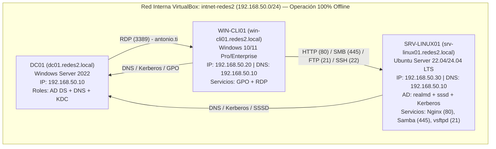

# Informe Técnico Académico — Fase A (Apartados 1 al 7 + Referencias APA 7)

> **Guía rápida de formato para Google Docs / Word (según `info.txt` Sección 7.1):**
> - **Tamaño de papel:** Carta | **Márgenes:** 2.5 cm en los cuatro lados
> - **Tipografía:** Arial o Times New Roman (elegir una para todo el documento)
> - **Texto principal:** 12 puntos, interlineado `1.5`, alineación **justificada**, sangría de primera línea `1.27 cm`
> - **Títulos principales:** 14 puntos, negritas | **Subtítulos:** 12 puntos, negritas
> - **Numeración:** Todas las páginas numeradas | **Tablas y figuras:** Numeradas, tituladas y con fuente
> - **Citas y referencias:** Normas APA 7.ª edición (todas las fuentes citadas dentro del texto)

---

## 1. Portada Institucional *(Plantilla — completar datos entre corchetes)*

**Universidad Autónoma de Aguascalientes (UAA)**  
**Centro / Facultad:** [Nombre del Centro Académico]  
**Programa Académico:** [Nombre de la Carrera, ej. Ingeniería en Sistemas Computacionales / Tecnologías de la Información]  
**Asignatura:** Administración de Sistemas  
**Unidad Temática:** Administración de servidores Windows y Linux  

**Título del Proyecto:**  
**Diseño e Implementación de una Infraestructura de Red Interoperable con Active Directory, Cliente Windows y Servicios de Red en Linux (`redes2.local`)**

**Integrantes del Equipo:**
- Carlos Antonio (Antonio) — *Arquitectura de red, pruebas end-to-end y coordinación documental*
- Joao — *Controlador de Dominio Windows Server y Active Directory (`DC01`)*
- Joshua (Josh) — *Cliente Windows y servicios de administración (`WIN-CLI01`)*
- Rodrigo (Rodri) — *Integración de servidor Linux a Active Directory (`SRV-LINUX01`)*
- Leonardo (Leo) — *Servicios de red en Linux: Nginx, Samba y vsftpd (`SRV-LINUX01`)*

**Docente:** [Nombre completo del docente]  
**Fecha de entrega:** [Día de mes de año]  

---

## 2. Resumen Ejecutivo *(Borrador Fase A — ajustar tras pruebas finales)*

El presente informe técnico documenta el diseño, implementación y validación de una infraestructura de red empresarial heterogénea e interoperable desplegada en Oracle VM VirtualBox. La arquitectura integra tres nodos virtuales conectados mediante una red interna aislada (`intnet-redes2`, segmento `192.168.50.0/24`) bajo el dominio de Active Directory `redes2.local`: un controlador de dominio en Windows Server 2022 (`DC01`, `192.168.50.10`) encargado de los servicios de directorio (AD DS) y resolución de nombres (DNS); un equipo cliente Windows 10/11 Pro/Enterprise (`WIN-CLI01`, `192.168.50.20`) administrado mediante Políticas de Grupo (GPO) y Escritorio Remoto (RDP); y un servidor Linux Ubuntu Server (`SRV-LINUX01`, `192.168.50.30`) unido al dominio mediante `realmd`, `sssd` y Kerberos para ofrecer tres servicios de red con autenticación centralizada: servidor web (Nginx), servidor de archivos (Samba) y servidor de transferencia de archivos (vsftpd). El diseño garantiza la operación autónoma sin dependencia de conectividad externa a internet durante las pruebas de validación y demostración práctica.

---

## 3. Índice General *(Actualizar automáticamente en Google Docs / Word)*

1. Portada Institucional  
2. Resumen Ejecutivo  
3. Índice General  
4. Introducción  
5. Objetivos  
   5.1 Objetivo General  
   5.2 Objetivos Específicos  
6. Marco Teórico  
   6.1 Infraestructuras Heterogéneas y Administración Centralizada  
   6.2 Active Directory Domain Services (AD DS) y DNS  
   6.3 Protocolo Kerberos e Integración Linux-AD (`realmd` y `sssd`)  
   6.4 Administración de Clientes Windows: Políticas de Grupo (GPO) y RDP  
   6.5 Servicios de Red en Linux: Nginx, Samba y vsftpd  
7. Diseño de Infraestructura  
   7.1 Topología de Red y Estrategia de Virtualización Offline  
   7.2 Tabla de Direccionamiento IP y Nodos Virtuales  
   7.3 Estructura Lógica de Active Directory (OUs, Grupos y Usuarios)  
   7.4 Política de Respaldo mediante Instantáneas (*Snapshots*)  
8. Desarrollo e Implementación *(Joao, Josh y Rodri — Fase B)*  
9. Configuración de Servicios *(Josh y Leo — Fase B)*  
10. Pruebas y Resultados *(Antonio y Equipo — Fase B/C)*  
11. Conclusiones Grupales *(Todos — Fase C)*  
12. Conclusiones Individuales *(Los 5 integrantes — Fase C)*  
13. Referencias Bibliográficas (APA 7)  
14. Anexos  

---

## 4. Introducción

En los entornos corporativos actuales, las infraestructuras tecnológicas rara vez dependen de un único sistema operativo. Por el contrario, es común encontrar arquitecturas heterogéneas donde las estaciones de trabajo de los usuarios y la gestión centralizada de identidades operan sobre plataformas Microsoft Windows, mientras que los servicios de red, publicación web y almacenamiento de archivos se despliegan en servidores GNU/Linux debido a su estabilidad, eficiencia en el uso de recursos y flexibilidad operativa (Canonical, 2024; Red Hat, s. f.).

Sin embargo, administrar cuentas, contraseñas y permisos de forma aislada en cada servidor genera duplicidad administrativa, inconsistencias de seguridad y una mayor superficie de error humano. Para resolver este desafío, resulta fundamental integrar los distintos sistemas operativos bajo un mismo esquema de autenticación centralizada mediante Active Directory Domain Services (AD DS), respaldado por el Sistema de Nombres de Dominio (DNS) y el protocolo de autenticación Kerberos (Microsoft, 2024a; SSSD, 2024).

El presente proyecto aborda el diseño, implementación y verificación práctica de dicha interoperabilidad mediante tres máquinas virtuales en VirtualBox (`DC01`, `WIN-CLI01` y `SRV-LINUX01`), demostrando cómo una identidad única creada en Windows Server puede autenticarse en un cliente Windows sujeto a directivas de seguridad, acceder a un servidor Linux por consola o SSH con control basado en grupos y consumir servicios HTTP, SMB/CIFS y FTP en una red interna completamente autónoma.

---

## 5. Objetivos

### 5.1 Objetivo General
Diseñar e implementar una infraestructura de red integrada mediante Active Directory, Windows y Linux bajo el dominio `redes2.local`, configurando servicios de autenticación centralizada y cinco servicios de red operativos que demuestren la interoperabilidad entre sistemas operativos heterogéneos.

### 5.2 Objetivos Específicos
1. Instalar y configurar un controlador de dominio en Windows Server 2022 (`DC01`) con los roles de Active Directory Domain Services (AD DS) y DNS Server.
2. Estructurar el dominio `redes2.local` mediante Unidades Organizativas (OUs), grupos de seguridad y cuentas de usuario de laboratorio.
3. Integrar un equipo cliente Windows Pro/Enterprise (`WIN-CLI01`) al dominio, validando el inicio de sesión centralizado e implementando dos funcionalidades administrativas: Políticas de Grupo (GPO) y Escritorio Remoto (RDP).
4. Instalar y configurar un servidor Ubuntu Server (`SRV-LINUX01`), integrándolo al dominio de Active Directory mediante `realmd`, `sssd` y Kerberos con control de acceso por grupos (`realm permit`).
5. Desplegar y comprobar tres servicios de red en Linux interoperables con el cliente Windows: servidor web (Nginx), servidor de archivos integrado con AD (Samba) y servidor FTP autenticado con AD (vsftpd).
6. Validar la conectividad, resolución DNS, autenticación centralizada y operación integral de la infraestructura en modo 100% offline, documentando cada procedimiento y evidencia bajo formato académico APA 7.

---

## 6. Marco Teórico

### 6.1 Infraestructuras Heterogéneas y Administración Centralizada
En infraestructuras empresariales modernas es habitual combinar servidores basados en Windows Server, encargados de la gestión centralizada de identidades mediante Active Directory Domain Services (AD DS), con servidores Linux especializados en la provisión de servicios de red por su estabilidad, bajo consumo de recursos y flexibilidad de configuración (Canonical, 2024; Red Hat, s. f.). Centralizar la identidad permite aplicar políticas uniformes de contraseñas, trazabilidad de accesos y control basado en grupos desde un único punto administrativo, evitando la gestión fragmentada de usuarios locales en cada nodo de la red.

### 6.2 Active Directory Domain Services (AD DS) y DNS
Active Directory Domain Services (AD DS) es el servicio de directorio de Microsoft que almacena información sobre los objetos de la red —como usuarios, grupos, equipos y unidades organizativas— y los pone a disposición de administradores y usuarios de forma jerárquica y segura (Microsoft, 2024a). Dentro de un dominio AD DS, las Unidades Organizativas (OUs) funcionan como contenedores lógicos que permiten organizar objetos y delegar administración o vincular directivas de grupo de manera granular (Microsoft, 2024b).

El funcionamiento de Active Directory depende estrechamente del Sistema de Nombres de Dominio (DNS). A través de registros de recursos estándar (como registros `A` para resolución directa y `PTR` para resolución inversa) y registros de servicio (`SRV`), DNS permite a los clientes y servidores localizar los controladores de dominio, servidores de catálogo global y centros de distribución de claves dentro de la red (Microsoft, 2024c). Sin una resolución DNS consistente, los procesos de unión al dominio y autenticación fallan.

### 6.3 Protocolo Kerberos e Integración Linux-AD (`realmd` y `sssd`)
Kerberos es el protocolo principal de autenticación en redes Active Directory; utiliza criptografía de clave simétrica y un esquema basado en *tickets* emitidos por el Centro de Distribución de Claves (KDC, ejecutado en el controlador de dominio) para verificar la identidad de usuarios y servicios sin transmitir contraseñas en texto claro por la red (Microsoft, 2024a). Un requisito crítico de Kerberos es la sincronización horaria entre todos los equipos participantes, ya que los *tickets* incluyen marcas de tiempo que toleran un desfase máximo estándar de cinco minutos.

Para integrar sistemas GNU/Linux a un dominio de Active Directory se emplea el conjunto formado por `realmd` y `SSSD` (*System Security Services Daemon*). Como documenta Red Hat (s. f.), `realmd` automatiza el descubrimiento del dominio, la configuración de Kerberos y la incorporación del equipo Linux como objeto dentro de Active Directory, mientras que `sssd` gestiona la comunicación con el controlador de dominio, la resolución de identidades (UID/GID), la caché de credenciales y el control de acceso por grupos mediante reglas como `realm permit` (SSSD, 2024). De este modo, los usuarios autenticados centralmente acceden tanto al sistema operativo Linux como a sus servicios de red sin duplicar cuentas locales (SSSD, 2024).

### 6.4 Administración de Clientes Windows: Políticas de Grupo (GPO) y RDP
Las Políticas de Grupo (GPO, *Group Policy Objects*) constituyen el mecanismo nativo de Windows Server para definir configuraciones de seguridad, restricciones de interfaz y parámetros del sistema de forma centralizada sobre usuarios o equipos pertenecientes a una OU específica (Microsoft, 2024b). Por ejemplo, es posible restringir el acceso a herramientas administrativas como el Panel de Control o la aplicación de Configuración para perfiles no administrativos, verificando su aplicación mediante herramientas como `gpresult`.

Por su parte, el Protocolo de Escritorio Remoto (RDP, *Remote Desktop Protocol*) permite a los administradores conectarse de forma gráfica e interactiva a estaciones de trabajo o servidores remotos a través de la red (Microsoft, 2024d). Integrado con Active Directory, el acceso RDP puede limitarse exclusivamente a grupos de seguridad autorizados (como el área de TI), fortaleciendo el principio de mínimo privilegio.

### 6.5 Servicios de Red en Linux: Nginx, Samba y vsftpd
*(Integración del aporte técnico de Leonardo — Módulo 04)*

1. **Servidor Web Nginx (Protocolo HTTP):** Nginx es un servidor web de código abierto de alto rendimiento basado en una arquitectura asíncrona y orientada a eventos (*event-driven*), capaz de atender múltiples conexiones concurrentes con un consumo reducido de memoria en comparación con modelos tradicionales basados en procesos por conexión (F5 NGINX, 2024). En `SRV-LINUX01`, permite publicar un portal informativo institucional accesible desde el cliente Windows mediante su nombre DNS (`http://srv-linux01.redes2.local`), validando la resolución DNS directa gestionada por `DC01` y la comunicación TCP/IP en `intnet-redes2`.
2. **Servidor de Archivos Samba (Protocolo SMB/CIFS Integrado con AD):** Samba es una implementación libre del conjunto de protocolos SMB/CIFS (*Server Message Block / Common Internet File System*), estándar nativo de Microsoft Windows para compartir archivos e impresoras en red (Samba Team, 2024a). Mediante sus demonios (`smbd`, `nmbd` y `winbindd`), Samba permite configurar el servidor Linux como miembro de un dominio Active Directory (`security = ads`), validando credenciales vía Kerberos y aplicando permisos sobre recursos compartidos con base en grupos de seguridad de AD (Samba Team, 2024b).
3. **Servidor de Transferencia de Archivos vsftpd (Protocolo FTP Autenticado con AD):** El protocolo FTP permite la transferencia de archivos sobre TCP empleando el puerto 21 para control y el puerto 20 o un rango pasivo para datos (Canonical, 2024). `vsftpd` (*Very Secure FTP Daemon*) destaca por su enfoque en seguridad, soporte de confinamiento `chroot` e integración con PAM (*Pluggable Authentication Modules*) (Evans, s. f.). Al delegar la validación al módulo `pam_sss` y habilitar `pam_mkhomedir`, `vsftpd` autentica directamente a los usuarios de Active Directory sin requerir cuentas locales adicionales (SSSD, 2024; Red Hat, s. f.).

---

## 7. Diseño de Infraestructura

### 7.1 Topología de Red y Estrategia de Virtualización Offline
La infraestructura se despliega en **Oracle VM VirtualBox** utilizando una estrategia de doble adaptador de red para asegurar que el dominio opere de manera **100% autónoma (offline)** durante las pruebas finales y la exposición presencial:

- **Adaptador 1 — Red del Dominio (Obligatorio):** Conectado a *Red interna* (`Internal Network`) con identificador exacto `intnet-redes2`, segmento `192.168.50.0/24` (máscara `255.255.255.0`). No se configura puerta de enlace en este adaptador para evitar conflictos de ruteo con el adaptador NAT durante la instalación de paquetes.
- **Adaptador 2 — NAT (Temporal):** Utilizado únicamente durante la fase de instalación para descarga de paquetes y actualizaciones. Se desconecta antes de las pruebas finales y del snapshot `05-DEMO-FINAL` para comprobar que el dominio `redes2.local` y todos sus servicios operan sin acceso a internet ni DNS externos.
- **Zona horaria estandarizada:** `America/Mexico_City` (UTC-6) en las tres máquinas virtuales para garantizar la validez de los *tickets* Kerberos.

*Figura 1.* Diagrama lógico de la arquitectura de red `redes2.local` sobre `intnet-redes2`. *Fuente:* Elaboración propia.

### 7.2 Tabla de Direccionamiento IP y Nodos Virtuales

| Máquina Virtual | Sistema Operativo | Hostname | FQDN | IP Estática (`intnet-redes2`) | DNS Primario | RAM Sugerida | Disco | Responsable |
| :--- | :--- | :--- | :--- | :--- | :--- | :--- | :--- | :--- |
| Controlador de Dominio | Windows Server 2022 (Desktop Experience) | `DC01` | `dc01.redes2.local` | `192.168.50.10` | `127.0.0.1` / `192.168.50.10` | 4 GB | 40 GB | Joao |
| Cliente Windows | Windows 10/11 Pro o Enterprise | `WIN-CLI01` | `win-cli01.redes2.local` | `192.168.50.20` | `192.168.50.10` | 4 GB | 40 GB | Josh |
| Servidor Linux | Ubuntu Server 22.04 / 24.04 LTS | `SRV-LINUX01` | `srv-linux01.redes2.local` | `192.168.50.30` | `192.168.50.10` | 2 GB | 25 GB | Rodri + Leo |

*Tabla 1.* Especificación técnica y direccionamiento IP de las máquinas virtuales. *Fuente:* Elaboración propia.

### 7.3 Estructura Lógica de Active Directory (OUs, Grupos y Usuarios)
El dominio `redes2.local` (nombre NetBIOS: `REDES2`) organiza sus objetos bajo la unidad organizativa raíz `OU=Empresa`, subdividida en cuatro OUs funcionales:
- `OU=TI`: Alberga al personal de soporte y administración (`GRP_TI`, `GRP_LinuxAdmins`).
- `OU=Desarrollo`: Alberga a los desarrolladores con acceso a servicios Linux (`GRP_Desarrollo`).
- `OU=Administracion`: Alberga usuarios estándar sujetos a la política restrictiva `GPO_Restriccion_Admin` (`GRP_Administracion`).
- `OU=Equipos`: Contiene los objetos de equipo `WIN-CLI01` y `SRV-LINUX01`.

| Nombre Completo | Usuario (`sAMAccountName`) | UPN | OU | Grupos | Rol en Pruebas |
| :--- | :--- | :--- | :--- | :--- | :--- |
| Joao Admin | `joao.admin` | `joao.admin@redes2.local` | `OU=TI` | `GRP_TI`, `GRP_LinuxAdmins` | Administración y SSH/sudo en Linux |
| Joshua Cliente | `josh.user` | `josh.user@redes2.local` | `OU=Administracion` | `GRP_Administracion` | Login en `WIN-CLI01`, prueba GPO y prueba negativa Linux |
| Rodrigo Linux | `rodri.dev` | `rodri.dev@redes2.local` | `OU=Desarrollo` | `GRP_Desarrollo` | Login AD en `SRV-LINUX01` (consola y SSH) |
| Leonardo Servicios | `leo.dev` | `leo.dev@redes2.local` | `OU=Desarrollo` | `GRP_Desarrollo` | Pruebas de Samba y FTP con AD desde `WIN-CLI01` |
| Antonio Redes | `antonio.ti` | `antonio.ti@redes2.local` | `OU=TI` | `GRP_TI` | Prueba de Escritorio Remoto (RDP) hacia `WIN-CLI01` |

*Tabla 2.* Cuentas de usuario y asignación de grupos en Active Directory. *Fuente:* Elaboración propia.

### 7.4 Política de Respaldo mediante Instantáneas (*Snapshots*)
Para garantizar la recuperabilidad ante errores de configuración, se estableció una secuencia obligatoria de cinco instantáneas en VirtualBox:
1. `01-OS-Base`: Sistemas operativos base instalados con hostname, zona horaria e IP estática configurados.
2. `02-AD-Listo`: `DC01` promovido con AD DS, DNS, OUs, grupos y usuarios creados.
3. `03-WinClient-Unido`: `WIN-CLI01` unido al dominio con GPO y RDP validados.
4. `04-Linux-Unido-AD`: `SRV-LINUX01` unido a `redes2.local` con `realmd`/`sssd`, `realm permit` y login AD comprobado.
5. `05-DEMO-FINAL`: Tres servicios Linux operativos, matriz de pruebas end-to-end aprobada y Adaptador 2 (NAT) desconectado.

---

## 13. Referencias Bibliográficas (Formato APA 7.ª Edición)

Canonical. (2024). *Ubuntu Server documentation*. Canonical Ltd. https://ubuntu.com/server/docs

Evans, C. (s. f.). *vsftpd — Probably the most secure and fastest FTP server for UNIX-like systems*. https://security.appspot.com/vsftpd.html

F5 NGINX. (2024). *NGINX documentation*. F5, Inc. https://nginx.org/en/docs/

Microsoft. (2024a). *Active Directory Domain Services overview*. Microsoft Learn. https://learn.microsoft.com/en-us/windows-server/identity/ad-ds/get-started/virtual-dc/active-directory-domain-services-overview

Microsoft. (2024b). *Group Policy overview*. Microsoft Learn. https://learn.microsoft.com/en-us/windows-server/identity/ad-ds/manage/group-policy/group-policy-overview

Microsoft. (2024c). *Active Directory and DNS*. Microsoft Learn. https://learn.microsoft.com/en-us/windows-server/identity/ad-ds/plan/active-directory-and-dns

Microsoft. (2024d). *Remote Desktop Services overview*. Microsoft Learn. https://learn.microsoft.com/en-us/windows-server/remote/remote-desktop-services/remote-desktop-services-overview

Red Hat. (s. f.). *How to join a Linux system to an Active Directory domain*. Red Hat Blog. https://www.redhat.com/en/blog/linux-active-directory

Samba Team. (2024a). *What is Samba?*. Samba Wiki. https://www.samba.org/samba/what_is_samba.html

Samba Team. (2024b). *Setting up Samba as a Domain Member*. Samba Wiki. https://wiki.samba.org/index.php/Setting_up_Samba_as_a_Domain_Member

SSSD. (2024). *System Security Services Daemon documentation*. SSSD Project. https://sssd.io/docs/introduction.html
